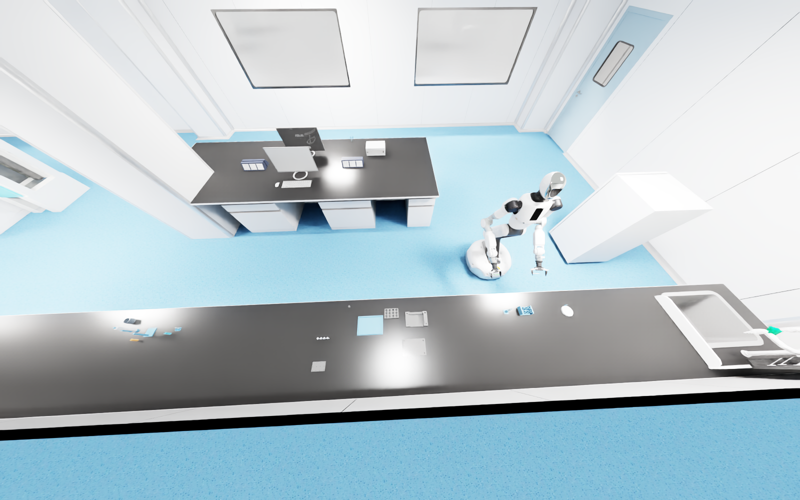

# Genesis Sim — wet-lab sandbox

One LabUtopia room with its original benches, Galbot, and equipment for five
mobile-manipulation tasks. Runs on **Isaac Sim 6.1**; Isaac Lab scene configuration
is retained for future training. The current scope is asset readiness and physical
inspection. Successful robot trajectories, trained policies, and vectorized
training are not qualified.



## Open-frame pipette task

The task provides an open rail frame over a black-top workbench, a
spring-return Gilson pipette, and a test tube. Choose `--robot mounted` (DexMate + DG-5F, the default),
`--robot floating` (floating DG-5F), or `--robot vega` (handless DexMate for
robot and scene inspection).

Use Isaac Sim 6.1, Isaac Lab 3 and an NVIDIA GPU. Set up a new asset cache once
with `--prepare`, then reuse it. The converter preserves the hand collision
pieces, authors pair exclusions, and supplies positive inertias for the six
floating-hand virtual links. When upgrading an older cache, run `--prepare` in a new directory to include the current visual meshes and the pipette’s refined hanger collider.

```bash
python -m pip install -e '.[cabinet]'
export OMNI_KIT_ACCEPT_EULA=YES
python scripts/run_cabinet_pipette.py --headless --assets outputs/cabinet_assets --prepare --num-envs 2
python scripts/run_cabinet_pipette.py --headless --assets outputs/cabinet_assets --robot floating --fixed-layout
python scripts/run_cabinet_pipette.py --headless --assets outputs/cabinet_assets --robot mounted --fixed-layout \
  --rgb outputs/cabinet.png --kit_args="--/renderer/multiGpu/enabled=false --/app/asyncRendering=false"
```

**Reset and control.** The frame and bench stay in place. By default the
pipette varies along the selected frame edge or with its rack and the tube varies independently in XY
on the bench. The sampler screens bar span, fixture clearance and
wrist reach at the approach points. Use `--fixed-pipette` or `--fixed-tube`
to disable either randomizer, or `--fixed-layout` to disable both. `--seed`
sets the placement seed.

The frame sits along the back edge of the bench and measures 1.20 m wide by 1.00 m high. Its estimated rectangular section is 100 mm front to back and 50 mm across each upright or vertically across each rail. The lower rail's top is 0.45 m above the bench. The bench is 1.55 m wide by 0.86 m deep by 0.865 m high. These dimensions are configurable estimates.

The rack crossbar and the lower frame rail both use static and dynamic friction coefficients of 1.5 with PhysX `max` combine. The rail coefficient is a modeling assumption. Physical friction against the lab frame has yet to be measured.

The default holder is the bench-mounted rack. Rack mode moves the rack and seated pipette together. Use `--holder frame-edge` to release the pipette with its finger hook over the lower rail. The nominal release balances the hanger above the edge and the body against the rail face. Randomization translates that pose by up to ±100 mm along the rail. Both modes randomize the tube independently. Use `--pipette-pose X Y Z W QX QY QZ` to override the nominal pose, or configure dimensions and ranges with `PipetteLayout`, `RailFrame` and `LabBench`.

For the frame-edge holder, the mounted robots turn 90° at the same base position to bring the rail and tube within right-wrist reach. Override the robot base position and orientation with `--robot-base-pose X Y Z W QX QY QZ` if your bench setup differs.

The pipette has ten body colliders and one plunger collider. Three convex pieces describe the exposed finger hook. Hanging depends on release orientation. On the 100 × 50 mm rail, CPU PhysX retained 15 of 27 pre-tilted releases over 6.5 s. With the supplied frame-edge pose, GPU PhysX retained the pipette at the fixed location and all eight sampled positions (seed 41) for all 650 steps.

Pass the layout to `cabinet_pipette_scene_cfg` and use
`reset_cabinet_pipette` for indexed resets. Control the robots through Isaac
Lab's articulation commands or the action configs in `wetlab_isaaclab.robots.actions`.

An indexed reset returns the sampled seat immediately. During the next ordinary physics tick, only the reset pipettes are parked 2 m above their seats to clear previous holder contacts. At the end of that tick they return to the sampled poses at rest, with the spring preload active. All robots continue taking commands, and reset itself advances the simulation clock by zero steps. The supplied scene leaves this parking space clear. For a custom free start, an occupied overhead space, or immediate pipette actuation, pass `settle_seat=False`. Explicit pipette pose, velocity or joint-state changes made after reset take precedence.

To check repeated randomized resets on GPU PhysX, run the native test once per holder with the converted asset directory. Each run relocates eight seated pipettes three times and leaves two moving robots in their original episodes.

```bash
python tests/native/check_indexed_pipette_reset.py --assets outputs/cabinet_assets --holder rack
python tests/native/check_indexed_pipette_reset.py --assets outputs/cabinet_assets --holder frame-edge
```

**Observations and events.** The launcher prints `event_outcomes`, with one
Boolean per world for each event. From Python, use `CabinetPipetteTask.observe()`
to read robot state, poses, plunger travel and axial contact force. Call
`task.reset(env_ids)` after resetting those worlds and `task.update()` once per
control (20 Hz in the example). It returns `valid`, `fixture_stable`,
`goal_reached`, `aligned`, `sustained_press`, and `success`.
At each control sample, success requires a valid state, a stable fixture, the
coarse goal and a nozzle inside the tube alignment window. The one-second
clock applies to retained pressing with at least 15 mm travel and over 0.1 N
axial force. The task checks nozzle alignment at the scoring sample. The launcher's small joint command checks scene stepping. A caller
supplies the manipulation controller.

**Camera.** `--rgb` enables native Isaac RTX RGB and writes one 640×480 PNG per
environment. The first verified camera launch took about 220 seconds on an
RTX 4090 with an X11 display available. Allow several minutes for startup.
Visual conversion preserves mesh geometry and uses OBJ without the source GLB
textures.

**Native press check.** Run this after preparing the asset cache. A floating DG-5F presses an aligned pipette whose body is clamped over the tube. The four worlds exercise a full press, a 14 mm lateral miss, an early release and a shallow stroke. Pickup and transport require a separate free-body run.

```bash
python tests/native/check_floating_press.py --assets outputs/cabinet_assets
```

## Equipment

| Task | Included assets |
| --- | --- |
| Petri opening/closing | 90 mm dish, independent lid with handling clip, parking target |
| Tube insertion | Free 16 × 100 mm tube, six-hole rack with 16.6 mm bores, tube stand |
| Reactor assembly | Original HTR basket, well, cover, PTFE insert, assembly jig, four independent M10×35 bolts, auxiliary disassembly plate |
| Fridge retrieval | Passive hinged door, handle, shelves, independent sample container |
| Pipetting | Spring-return plunger, detachable tip, tip rack, source/target vessels, disposal container, tracked liquid volumes |

| Dish and tube equipment | HTR reactor equipment |
| --- | --- |
|  |  |
|  |  |


These are inspection renders, not evidence of completed robot tasks. Dimensions,
masses, collision settings, provenance and target/grasp frames accompany the USDs
in `assets/htr/`, `assets/sandbox/` and `assets/generated/`.

## Run

Use an Isaac Sim **6.1** Python environment with its EULA accepted and an NVIDIA
GPU. The older Isaac Lab/Sim 5.1 environment is not a supported execution runtime.
Isaac Sim and its asset service are separate prerequisites, not bundled here.

```bash
python -m pip install -e .
export OMNI_KIT_ACCEPT_EULA=YES

# Full room, reusable equipment, composed USD and inspection figures
python scripts/run_sandbox.py --headless --task all --mode inspect --build-only --figures

# GUI: task selection, reset, robot targets, grippers, magnetic tool and stepping
python scripts/run_sandbox.py --task petri --mode interactive

# Asset checks; reports failures rather than silently accepting unstable fits
python scripts/validate_sandbox.py --scope assets
PYTHONPATH=source python -m unittest discover -s tests -v
```

Task IDs: `petri`, `tube_insertion`, `reactor_assembly`, `fridge_retrieval`,
`pipetting`. The launcher also supports `--seed`, `--petri-mode open|close`,
`--volume-ul`, and optional `--mode scripted`. Outputs and logs go to the ignored
`outputs/sandbox/` directory. Both launchers support `--help`.

## RoboLab cobot

The bundled [URDF](assets/robots/kinova_mobile_cobot/curobo/kinova_gen3_robolab.urdf)
is RoboLab's **planner-only Kinova Gen3 arm chain**. It intentionally contains no
mobile base, render meshes, masses or transmissions. The complete robot is the
[mobile-cobot USD](assets/robots/kinova_mobile_cobot/kinova_mobile_cobot.usda),
with its chassis, Kinova Gen3, Robotiq 2F-85 and dependent USD layers included.
CuRobo configuration and collision spheres are alongside the URDF.

```python
from wetlab_isaaclab.assets import COBOT_USD, COBOT_PLANNER_URDF
```

The sandbox's current robot controller is Galbot-specific. Bundling the cobot
assets does not qualify a cobot task controller or replace Galbot automatically.

## Physics and validation status

- Five task setups passed 20 reset cycles and ten-second stability tests; the
  composed USD passed reopening and a ten-second smoke test. These checks do not
  establish assembled reactor stability.
- Lid and tube seating, the passive fridge hinge and plunger spring return passed
  direct fixture tests. Eleven simulator-independent task tests cover rejection
  cases, reset state and pipetting volume conservation.
- **Reactor insert contact remains unqualified:** nominal and estimated-clearance
  tests showed jitter. All equipment is present, but full five-task physical
  feasibility has not passed acceptance.
- HTR CAD dimensions and measured masses are preserved. The insert's CAD diameter
  and bore are both 19.75 mm. Default `--insert-collision clearance` retains the
  CAD visual and uses an explicitly estimated 19.55 mm hollow compound collider;
  `--insert-collision nominal` restores nominal CAD contact. Real fit clearance
  still needs measurement. Other representative equipment properties, insert
  mass and contact parameters are estimates; see `assets/sandbox/htr_audit.json`.
- Magnetic handling is a contact-gated, force-limited constraint approximation.
  Pipetting tracks conserved volumes without fluid dynamics. Reactor bolts are
  placed without threading or tightening. Robot motion/base balance and GUI
  interaction on a display remain unqualified.

## Layout and provenance

`source/wetlab_isaaclab/sandbox/` contains equipment generation, scene composition,
robot control, task state and the shared `reset(seed, task)` / `step(action)` API.
The existing `Policy.reset()` / `Policy.act()` boundary is retained. Detailed
checks live under `sandbox/checks/`; only launch and validation scripts remain at
the top level. `assets/previews/` contains the images above.

- **LabUtopia:** [upstream](https://github.com/Rui-li023/labutopia), revision
  `8df72784265c375a327ffa3f0a0cf8c676f229a7`; lab assets retain **CC BY-NC 4.0**
  terms, including attribution and noncommercial restrictions. Our collision and
  scene overrides are separate layers.
- **Galbot:** fetched from NVIDIA's Isaac Sim 6.1 asset service, not redistributed
  here; NVIDIA's 3D Content Sharing Agreement applies to that model.
- **HTR:** derived from user-supplied STEP models and measurements; ownership and
  distribution rights remain with their owner. New representative equipment is
  generated locally; no ARTISAN models or paid generation service are required.
- **Cobot:** copied from RoboLab revision
  `0bc479299d0b41aa487d160ef58cbca03ac9a4f1`, including its local chassis changes.
  Kinova geometry derives from `ros2_kortex` revision
  `78e6dee598865f0f9b352f1a57b929dae14ce61a`; Robotiq geometry derives from
  `ros2_robotiq_gripper` revision `12e623212e6891a5fcc9af94d67b07e640916394`.
  BSD Kinova/Robotiq and Apache RoboLab license notices are retained alongside
  the assets. Their terms are not replaced by this repository.
