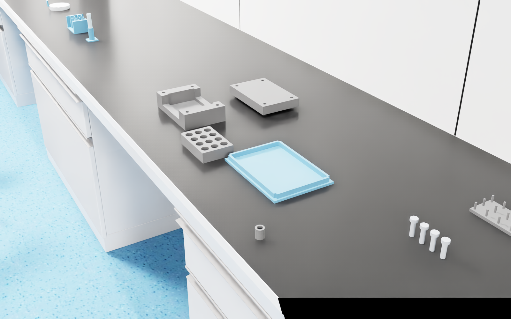
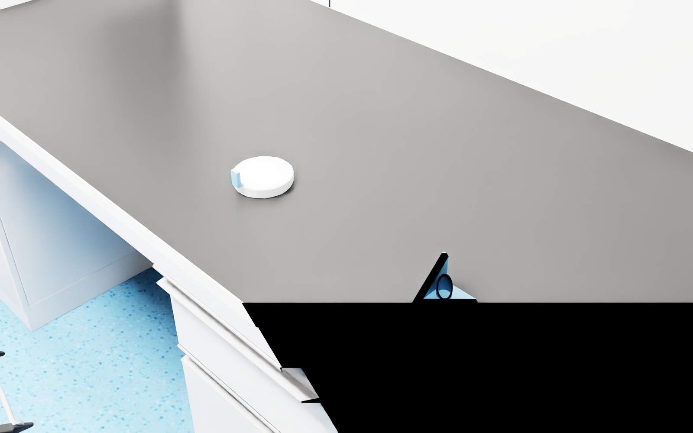
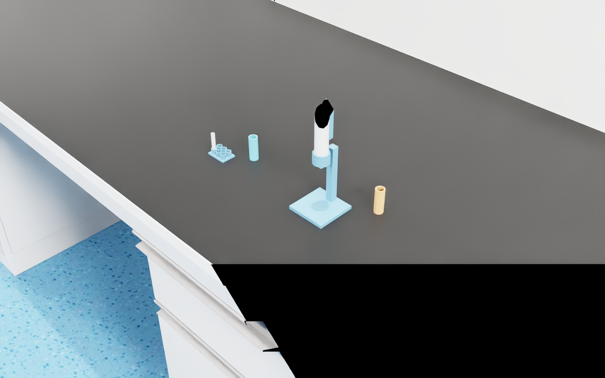
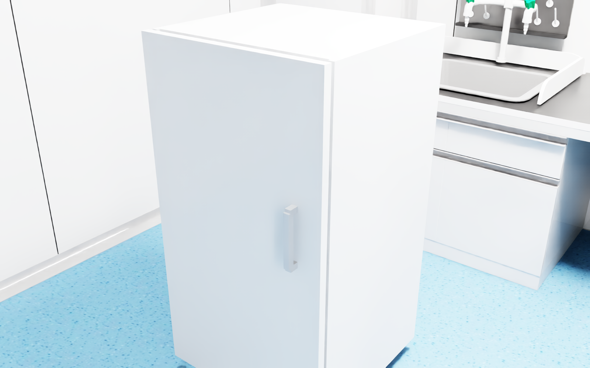

# Genesis Sim — wet-lab sandbox

One LabUtopia room with its original benches, Galbot, and equipment for five
mobile-manipulation tasks. Runs on **Isaac Sim 6.1**; Isaac Lab scene configuration
is retained for future training. The current scope is asset readiness and physical
inspection. Successful robot trajectories, trained policies, and vectorized
training are not qualified.


## Cabinet pipette task

This task is separate from the Galbot wet-lab sandbox. It provides a cabinet,
tube and spring-return pipette, and supports the mounted DexMate + DG-5F and
floating DG-5F. The handless Vega-1 is available for robot and scene inspection.

Use Isaac Sim 6.1 with Isaac Lab 3 and a GPU. Convert the sources into a new
cache on the first run. The converter preserves the hand collision pieces,
writes pair exclusions into each robot asset and supplies positive inertias
for the six virtual links of the floating robot.

```bash
python -m pip install -e '.[cabinet]'
python scripts/run_cabinet_pipette.py --headless --assets outputs/cabinet_assets --prepare --num-envs 2
python scripts/run_cabinet_pipette.py --headless --assets outputs/cabinet_assets --robot floating --fixed-layout
python scripts/run_cabinet_pipette.py --headless --assets outputs/cabinet_assets --fixed-layout --rgb outputs/cabinet.png
```

The `--rgb` option enables Isaac RTX camera observations and writes one PNG
per environment. Allow extra startup time on a cold renderer. Reconvert older
asset caches to populate the GLB visual sites. The importer uses staged OBJ
visual geometry without GLB textures. Collision assets are unchanged.

The default reset samples a pool of cabinet positions and yaw angles with
independent tube offsets. Each generated layout is screened for tube-to-cabinet
clearance and wrist reach at two approach points. Full hand and arm path
clearance depends on the controller and the deployment layout. The fixed switch
uses the nominal work surface and shelf pose. Pass a custom work surface and
layout to `cabinet_pipette_scene_cfg` to change the deployment scene.

Use `reset_cabinet_pipette` for indexed resets, the articulation command API
or the robot action configs to control the robot, and `CabinetPipetteTask.observe`
and `CabinetPipetteTask.update` for physical observations and event outcomes.
The launcher's wrist movement is a scene smoke test. The task reports the
physical conditions for alignment and sustained pressing without a controller
or a training objective.

## Equipment

| Task | Included assets |
| --- | --- |
| Petri opening/closing | 90 mm dish, independent lid with handling clip, parking target |
| Tube insertion | Free 16 × 100 mm tube, six-hole rack with 16.6 mm bores, tube stand |
| Reactor assembly | Original HTR basket, well, cover, PTFE insert, assembly jig, four independent M10×35 bolts, auxiliary disassembly plate |
| Fridge retrieval | Passive hinged door, handle, shelves, independent sample container |
| Pipetting | Spring-return plunger, detachable tip, tip rack, source/target vessels, disposal container, tracked liquid volumes |

| Dish and tube equipment | HTR reactor equipment |
| --- | --- |
|  |  |
|  |  |



These are inspection renders, not evidence of completed robot tasks. Dimensions,
masses, collision settings, provenance and target/grasp frames accompany the USDs
in `assets/htr/`, `assets/sandbox/` and `assets/generated/`.

## Run

Use an Isaac Sim **6.1** Python environment with its EULA accepted and an NVIDIA
GPU. The older Isaac Lab/Sim 5.1 environment is not a supported execution runtime.
Isaac Sim and its asset service are separate prerequisites, not bundled here.

```bash
python -m pip install -e .
export OMNI_KIT_ACCEPT_EULA=YES

# Full room, reusable equipment, composed USD and inspection figures
python scripts/run_sandbox.py --headless --task all --mode inspect --build-only --figures

# GUI: task selection, reset, robot targets, grippers, magnetic tool and stepping
python scripts/run_sandbox.py --task petri --mode interactive

# Asset checks; reports failures rather than silently accepting unstable fits
python scripts/validate_sandbox.py --scope assets
PYTHONPATH=source python -m unittest discover -s tests -v
```

Task IDs: `petri`, `tube_insertion`, `reactor_assembly`, `fridge_retrieval`,
`pipetting`. The launcher also supports `--seed`, `--petri-mode open|close`,
`--volume-ul`, and optional `--mode scripted`. Outputs and logs go to the ignored
`outputs/sandbox/` directory. Both launchers support `--help`.

## RoboLab cobot

The bundled [URDF](assets/robots/kinova_mobile_cobot/curobo/kinova_gen3_robolab.urdf)
is RoboLab's **planner-only Kinova Gen3 arm chain**. It intentionally contains no
mobile base, render meshes, masses or transmissions. The complete robot is the
[mobile-cobot USD](assets/robots/kinova_mobile_cobot/kinova_mobile_cobot.usda),
with its chassis, Kinova Gen3, Robotiq 2F-85 and dependent USD layers included.
CuRobo configuration and collision spheres are alongside the URDF.

```python
from wetlab_isaaclab.assets import COBOT_USD, COBOT_PLANNER_URDF
```

The sandbox's current robot controller is Galbot-specific. Bundling the cobot
assets does not qualify a cobot task controller or replace Galbot automatically.

## Physics and validation status

- Five task setups passed 20 reset cycles and ten-second stability tests; the
  composed USD passed reopening and a ten-second smoke test. These checks do not
  establish assembled reactor stability.
- Lid and tube seating, the passive fridge hinge and plunger spring return passed
  direct fixture tests. Eleven simulator-independent task tests cover rejection
  cases, reset state and pipetting volume conservation.
- **Reactor insert contact remains unqualified:** nominal and estimated-clearance
  tests showed jitter. All equipment is present, but full five-task physical
  feasibility has not passed acceptance.
- HTR CAD dimensions and measured masses are preserved. The insert's CAD diameter
  and bore are both 19.75 mm. Default `--insert-collision clearance` retains the
  CAD visual and uses an explicitly estimated 19.55 mm hollow compound collider;
  `--insert-collision nominal` restores nominal CAD contact. Real fit clearance
  still needs measurement. Other representative equipment properties, insert
  mass and contact parameters are estimates; see `assets/sandbox/htr_audit.json`.
- Magnetic handling is a contact-gated, force-limited constraint approximation.
  Pipetting tracks conserved volumes without fluid dynamics. Reactor bolts are
  placed without threading or tightening. Robot motion/base balance and GUI
  interaction on a display remain unqualified.

## Layout and provenance

`source/wetlab_isaaclab/sandbox/` contains equipment generation, scene composition,
robot control, task state and the shared `reset(seed, task)` / `step(action)` API.
The existing `Policy.reset()` / `Policy.act()` boundary is retained. Detailed
checks live under `sandbox/checks/`; only launch and validation scripts remain at
the top level. `assets/previews/` contains the images above.

- **LabUtopia:** [upstream](https://github.com/Rui-li023/labutopia), revision
  `8df72784265c375a327ffa3f0a0cf8c676f229a7`; lab assets retain **CC BY-NC 4.0**
  terms, including attribution and noncommercial restrictions. Our collision and
  scene overrides are separate layers.
- **Galbot:** fetched from NVIDIA's Isaac Sim 6.1 asset service, not redistributed
  here; NVIDIA's 3D Content Sharing Agreement applies to that model.
- **HTR:** derived from user-supplied STEP models and measurements; ownership and
  distribution rights remain with their owner. New representative equipment is
  generated locally; no ARTISAN models or paid generation service are required.
- **Cobot:** copied from RoboLab revision
  `0bc479299d0b41aa487d160ef58cbca03ac9a4f1`, including its local chassis changes.
  Kinova geometry derives from `ros2_kortex` revision
  `78e6dee598865f0f9b352f1a57b929dae14ce61a`; Robotiq geometry derives from
  `ros2_robotiq_gripper` revision `12e623212e6891a5fcc9af94d67b07e640916394`.
  BSD Kinova/Robotiq and Apache RoboLab license notices are retained alongside
  the assets. Their terms are not replaced by this repository.
